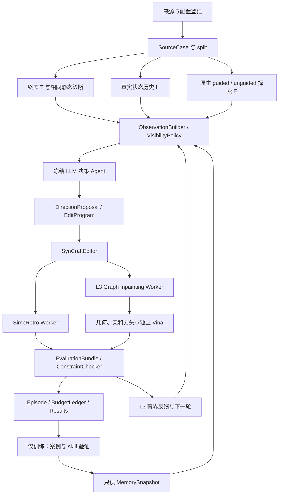
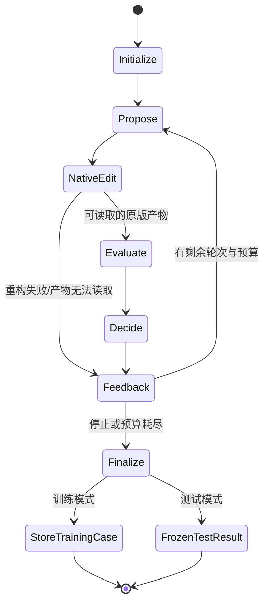

# AgenticGen 项目架构

版本：架构设计 2.2。初稿日期：2026-10-14。更新日期：2026-10-19。需求依据：[完整项目计划](PROJECT_PLAN.md)。

当前运行底座是 `FoundationConfig → base_factory → NativeSynCraftAgent → 固定 pass-K → graph/retro/geometry → SelectionPolicy → base_reporting`，覆盖 SynCraft 标准与结合约束模式。Flow 历史属于可选的 EvidenceInjector 输入。2026-10-19 新增 `design → 原生 Graph / Fragment inpainting → 实际 pose 评价`，实现与可运行边界见 [FLOWR_INPAINTING.md](FLOWR_INPAINTING.md)。旧 `agenticgen.run.v1` 单轮局部编辑路径保留兼容；以下 H/E 自动数据采集、共享动作池、经验记忆和 worker 集群仍为后续研究契约。

## 1. 架构目标

系统围绕三个实验级别组合信息与执行能力：L1 增加历史，L2 增加原生探索，L3 增加反馈迭代与经验证经验。所有组共用原版 SynCraft 图重构、逆合成评价、来源登记和预算账本；实验因子由宿主配置控制，不由 Agent 自行开启。

LLM 负责选择方向、提出显式图编辑、陈述事前预期及引用证据。宿主负责测量、图执行、生成器调用、逆合成、约束判断与实验统计。已有 MolSteer 的奖励公式合成和实时梯度注入不是本项目的默认动作空间。

首版采用单一决策 Agent，配套确定性观察构建器和工具。增设多个 LLM 角色会增加新的实验因素，后续需要单独评价。

## 2. 总体数据流



L1/L2 不启用 GEOM、Q、NEXT 或共享记忆写入。数据采集时可以保存终态坐标和口袋，但编辑产物的三维生成不作为这两级的评价条件。L3 训练可写经验；L3 测试只消费已冻结快照。

## 3. 仓库与依赖组织

### 3.1 当前仓库

```text
AgenticGen/
├── .git/
├── .gitignore
├── pyproject.toml
├── uv.lock
├── README.md
├── src/agenticgen/        # contracts, ports, adapters, agent, editor, runner, reporting
├── examples/ck2_top3/     # 真实候选、原始坐标、配置、显式 replay 测试输入
├── tests/                # 接口与化学约束测试
├── scripts/              # 示例启动与 schema 导出
├── schemas/              # 从 Pydantic/Agent 输出协议导出的 JSON Schema
└── docs/                 # 计划、架构、运行指南、接入分析和验证记录
```

AgenticGen 独立保存 Git 历史，父 MolSteer 使用本地 `.git/info/exclude` 忽略此子目录，避免误将独立仓库加入父仓库。当前不配置远程地址或 Git submodule。后续外部依赖安装位置通过宿主配置解析，公共配置保存版本与变量引用。

### 3.2 后续代码布局

```text
AgenticGen/
├── pyproject.toml
├── configs/
│   ├── defaults.yaml
│   ├── dependencies.example.yaml
│   ├── providers.example.yaml
│   ├── data_protocol.yaml
│   ├── level1.yaml
│   ├── level2.yaml
│   └── level3.yaml
├── prompts/
│   ├── policy_system.md
│   ├── terminal_context.md
│   ├── history_context.md
│   ├── exploration_context.md
│   ├── feedback_context.md
│   ├── memory_context.md
│   └── skill_proposal.md
├── schemas/
│   ├── source_case.schema.json
│   ├── trajectory_packet.schema.json
│   ├── exploration_packet.schema.json
│   ├── observation_bundle.schema.json
│   ├── edit_program.schema.json
│   ├── direction_proposal.schema.json
│   ├── evaluation_bundle.schema.json
│   ├── skill_card.schema.json
│   └── run_manifest.schema.json
├── src/agenticgen/
│   ├── cli.py
│   ├── contracts/
│   ├── provenance/
│   ├── data/
│   ├── observations/
│   ├── agents/
│   ├── editing/
│   ├── evaluation/
│   ├── memory/
│   ├── experiments/
│   ├── reporting/
│   └── adapters/
│       ├── molsteer.py
│       ├── syncraft.py
│       ├── flowr_native.py
│       ├── flowr_inpainting.py
│       └── simpretro.py
├── scripts/
│   ├── collect_sources.py
│   ├── build_dataset.py
│   ├── build_action_pools.py
│   ├── run_level1.py
│   ├── collect_native_exploration.py
│   ├── run_level2.py
│   ├── acquire_memory.py
│   ├── run_level3.py
│   └── analyze_runs.py
├── tests/
│   ├── unit/
│   ├── contract/
│   └── integration/
├── docs/
└── outputs/                  # 运行时生成、Git 忽略
```

不复制整个第三方源码到新包。需要对上游 hook 进行改造时，使用可审查的适配代码/补丁并记录来源，原版基线使用无该补丁的可识别路径。研究数据和模型权重不进入 Git。

### 3.3 执行环境

控制面使用 Pydantic、JSON Schema、RDKit 和必要的模型服务接口；当前锁文件已在 Windows/Python 3.13.3 验证。MolReader/MolSteer 按已验证依赖版本接入。FLOWR GPU worker 与 SimpRetro CPU worker 独立环境或容器，避免旧版 Syntheseus/RDChiral 与生成器依赖相互影响。控制面安装成功不代表这些独立 worker 的环境已就绪。

各 worker 以受控 JSON 请求和产物 ID 交互，输出结构化结果与引用；LLM 不直接传入任意本地文件路径或 shell 命令。宿主配置负责工作区、凭据和依赖位置，领域数据只保存不含密钥的引用。

## 4. 模块职责

| 模块 | 输入 | 输出 | 职责与边界 |
| --- | --- | --- | --- |
| DependencyRegistry | 依赖位置、Git/文件/权重指纹 | DependencyManifest | 登记实际版本、词表、能力和引用；避免父库 revision 冒充上游 |
| SourceCollector | 准备后口袋、生成配置、checkpoint | SourceCase、TrajectoryPacket、runtime 引用 | 原始采集与世界坐标转换；不依据未来优化结果选样 |
| SplitManager | 案例身份、同源与骨架信息 | SplitManifest | 全 lineage 同组；RAG/记忆/test 隔离 |
| ObservationBuilder | T/H/E、约束、只读记忆 | ObservationBundle | 生成带证据 ID 的数值/图摘要，不编造机理原因 |
| VisibilityPolicy | 实验组、工具能力 | 允许字段、工具和 artifact IDs | 防止终态组通过工具路径读到历史或隐藏标签 |
| DirectionAgent | 可见观察、动作空间 | DirectionProposal、排序与 EditProgram | 冻结模型调用；不执行图编辑、不写评价结果 |
| ActionPoolBuilder | 原始图、统一候选策略 | SharedActionPool | 对实验组独立；生成后才赋隐藏评价标签 |
| SynCraftEditor | 原图与 EditProgram | GraphEditResult | 调用原版重构；记录忽略后的最终图、最大分子片段与原始输出 |
| RetroEvaluator | 可读取产物图与 RetroProtocol | RetroResult | 统一预算内路线评价与缓存；区分失败状态 |
| NativeExplorationCollector | 原生 FLOWR 任务 | ExplorationPacket | L2 原始 SMC/无引导候选和 ancestry |
| GraphInpaintingWorker | 新图、口袋、mask/初始配置 | ConformerBatch | L3 三维候选；固定目标图并检查实际产物 |
| GeometryEvaluator | 父/新图及对应构象 | GeometryResult | 几何、局部松弛、亲和力头、独立 docking |
| EpisodeRunner | 策略、评价、轮次和预算 | EpisodeRecord | 实验组的有界反馈、接受/拒绝及停止 |
| CaseMemory/SkillRegistry | 已评估训练 episode | 案例、SkillCard、冻结快照 | 支持条件检索、正负证据、验证与版本；测试禁止共享写入 |
| BudgetLedger/ResultStore | 调用事件与产物 | 查询成本、运行记录、结果表 | 物理/逻辑成本分开；缓存/重试可追溯 |
| Analyzer | 配对结果、split、协议 | 效应、区间、覆盖与错误分层 | 不将阶段帧当独立样本；不修改原始运行记录 |

## 5. 适配器接口与实际能力

接口使用宿主构造的 typed request，以下为计划中的语言无关契约；具体类与 import 在实现阶段确定。

```python
class MeasurementPort:
    def measure(self, artifact_ref, *, view, metric_ids, protocol) -> MetricBundle: ...

class GraphEditPort:
    def apply(self, graph_ref, program, constraints) -> GraphEditResult: ...

class RetrosynthesisPort:
    def evaluate(self, graph_ref, protocol, budget) -> RetroResult: ...

class NativeFlowrPort:
    def collect(self, request) -> SourceCollection: ...
    def sample_native(self, request) -> ExplorationPacket: ...
    def continue_from_runtime(self, request) -> ContinuationResult: ...

class GraphInpaintingPort:
    def sample_fixed_graph(self, request) -> ConformerBatch: ...

class PolicyPort:
    def propose(self, observation, action_pool=None) -> DirectionProposal: ...

class MemoryPort:
    def retrieve(self, query, snapshot_ref, limit) -> MemoryBundle: ...
    def ingest_training_episode(self, episode_ref) -> CaseRecord: ...
    def publish_snapshot(self, validated_skill_refs) -> MemorySnapshot: ...
```

### 5.1 MolSteer 适配器

优先复用 `molreader.io`、`molreader.packet` 和指标模块，转换其 StatePacket/MetricResult 到 AgenticGen 的观察 envelope。保留 `state/prediction/sdf`、单位、坐标框架、原子映射、status、来源和版本，不删掉原有“不适用/不可用”状态。

读取 `integrations/flowr_root/stage_runner.py` 所输出的 state/prediction/world/runtime；新采集器需要支持可配置阶段，并在原生采样边界保存准确时间。数据迁移只做格式适配，不重标记旧文件的生成阶段。

按 2026-10-15 用户新增需求，当前 LLM 由 `EvoMolSteerDeepSeek` 适配器复用 EvoMolSteer 的 `deepseek_api.call_json`，默认精确调用 `deepseek-flash`。MolSteer 的模型 profile 构造器保留为未来可选适配器，不是现行默认；不启动其生物/数学双专家完整流程。主实验同组共享模型 ID、服务、采样参数、工具调用预算及请求格式。

### 5.2 SynCraft 适配器

使用其操作语言和提示词作为终态基线，保留原版调用/筛选配置以便外部比较。AgenticGen 的主因子对照使用同一个 PolicyPort 和基础 prompt，不能以替换整个 SynCraft prompt 模拟单纯加历史。

图执行直接使用原版 `reconstruct_from_sequence`，保留忽略不存在的键操作、重复加键及最大分子片段选择行为。宿主不再用独立参考图、逐条指令前置条件、保护邻域或编辑预算否决原版产物；这些字段作为提示指导和结果描述。下游工具无法读取原版输出时记录 `product_loading` 错误，保留原始返回值而不替换分子。实际图差异、裁片和上游版本须记录；评价器仍按统一协议检查相似度、SA、结合及路线。

### 5.3 FLOWR 原生适配器

`sample_native` 按锁定上游原生算法执行，不改变重采样权重定义；记录 value/subvalue、时间窗口、噪声、时间网格、particle 数、有效参数和实际选择权重。所检查普通 SMC 路径中 mu/sigma/maximize 不是有效权重控制参数，不将它们作为独立 steering 轴。

原始 full-run guided/unguided 是 L2 默认能力。`continue_from_runtime` 是独立可选能力，要求完整现场和兼容的 sampler；不存在时返回 `unsupported`。新噪声重启不得伪装成同状态恢复。SMC ancestry 的记录需要采样 hook；未有 ancestry 的历史不能用作同粒子局部轨迹。

### 5.4 FLOWR inpainting 适配器

L3 独立进程使用专门 graph-inpainting 路径，支持 conformer/random/harmonic 初始化，并明确终态回填、feature keys、词表和 checkpoint 对该模式的兼容性。对最终 RDKit 图核对元素、形式电荷、连接/键级、stereo、连通性与映射；核对失败则拒绝样本。

AgenticGen 已独立实现该端口，直接调用固定官方版本的 `generate_from_pdb.py`，不复用 MolSteer 不支持 mask 的恢复适配器。Graph 使用官方 harmonic prior，Fragment 使用原生 substructure keep-mask；实际映射、边界规则与模型兼容性以新增适配文档为准。

### 5.5 SimpRetro 适配器

在固定仓库 revision 的隔离 worker 中调用其 Syntheseus 搜索入口，提供目标列表、库存、模板、搜索算法、seed、时间预算和输出目录；上游 CLI 参数通过该版本的实际支持列表核验。

解析路线对象与模板信息，验证目标分子、叶原料库存归属及路线结构。原始产物按内容哈希保存，标准化结果供 AgenticGen 使用。扩展 AiZynthFinder 或其他后端时必须使用独立协议 ID，不能将不同后端的标签混为同一主真值。

## 6. 核心数据契约

所有 envelope 至少含 `schema_version`、`kind`、`id`、`created_at`、`source_refs`、`content_hash`；结构对象另带明确 representation 和 status。路径属于 ArtifactStore 的内部定位信息，Agent 只消费受许可的 artifact ID 与公开摘要。

### 6.1 SourceCase / SourceManifest

| 字段 | 含义 |
| --- | --- |
| case_id、target_id、ligand_id | 稳定来源身份 |
| split、target_cluster、scaffold_cluster | 数据隔离与统计分组 |
| final_graph_ref、final_geometry_ref | 终态图/坐标，所有组引用相同内容 |
| trajectory_ref、runtime_ref | 同次生成历史与完整现场引用 |
| generator_source、checkpoint_hash、vocabulary_hash | 实际模型与编码版本 |
| preparation_protocol、coordinate_transform | 口袋/配体准备与坐标单位/原点 |
| seed、batch_id、particle_id、ancestry_ref | 随机与采样来源 |
| baseline_retro_ref | 仅宿主用于主任务筛选；允许所有组获知同一初始任务标签 |
| inclusion/exclusion_status | 筛选与排除的原因 |

来源分子图与坐标分开登记，规范化不能丢失 stereo 或微状态。图身份使用 canonical isomeric SMILES 加 RDKit/规范化协议版本，不用普通非手性 SMILES 充当完全身份。

### 6.2 TrajectoryPacket / StateFrame

`frames` 严格按实际采样边界排序，记录 stage_t、原生 step_index、dt、view 和文件/张量引用。StateFrame 包含：coords、active_mask、slot_ids、atom/type 编码、bond 与 charge 编码、probability/logit 标识、词表、坐标框架与转换。原始 S_t、endpoint prediction 和 decoded graph 不可混称。

派生 ChangeEvent 包含两帧 ID、计算方法、单位、数值变化、涉及槽位/结构角色、mapping_status 和 evidence ID。数值差异不能自动写成“化学原因”。无效化学图允许记录坐标与类别变化；依赖有效图的指标返回 unavailable。

原生 slot ID 只在固定粒子 ancestry 内追踪；跨不同生成终态采用经核验的图匹配，并保留未匹配原子。原子类型改变与真实化学元素转化分别表述。

### 6.3 GeneratorRuntime

完整现场至少含 curr、prior、cond/self-conditioning、times/grid、pocket tensors/encoding/COM、Python/NumPy/Torch CPU/CUDA RNG、精度、设备、sampler flags、batch 顺序、active masks、权重/源码哈希，以及引导发生时的 population/ancestry。

将完整 batch 的 ligand 视图送给测量器可以用于观察；将切片状态直接用于“精确恢复”可能改变随机数消耗和粒子耦合，默认禁止。恢复分支登记 `live_exact`、`reconstructed` 或 `fresh_restart`，比较不能混用这些标签。

### 6.4 ExplorationPacket

含 exploration_kind=`native_fresh_guided`/`native_fresh_unguided`/`checkpoint_branch`、source_case_id、request/protocol、初始粒子组引用、原生目标/预测、particle ancestry、候选图和几何、无效/重复状态、相对 G0 的结构差异、预算账本。

E 中可提供原生生成时已使用的预测目标，但不能附上之后得到的候选 retro/隐藏方向标签。跨同口袋候选的 MCS/Tanimoto 属于结构差异，不声称是共享 atom slot 的位移。

### 6.5 ObservationBundle / DirectionProposal

ObservationBundle 含共同 task/constraints、terminal_context、可选 history_context、可选 exploration_context、memory_context、工具许可列表和所有可见 evidence IDs。宿主另存 arm_id；默认不把实验组名称加入模型 prompt。

DirectionProposal 的计划字段：

```json
{
  "kind": "DirectionProposal",
  "source_case_id": "example_case",
  "selected_candidate_id": "candidate_1",
  "ranked_candidates": [
    {
      "candidate_id": "candidate_1",
      "direction_label": "fragment_replacement",
      "edit_program_ref": "edit_program_1",
      "evidence_ids": ["ev_example"],
      "expected_effect": "希望移除已定位的局部合成难点",
      "constraint_risks": ["需检查保护片段与原子价态"],
      "brief_rationale": "可见证据所支持的简短依据"
    }
  ]
}
```

这是 schema 示意。期待的成功概率若未经校准，不输出伪精确数值。选择与排序在提交评价之前保存为不可改写记录；后续反思生成新的记录，不能覆盖先前选择。

### 6.6 EditProgram / GraphEditResult

EditProgram 绑定 source_graph_hash、atom-map 表、commands、候选方向、保护范围和约束协议。原始映射使用稳定身份，新原子 ID 从独立命名空间分配；使用 SynCraft 时其 >=500 约定必须在输入规模范围内无冲突。

GraphEditResult 保存原/新图、实际新增/删除/改变映射、相似度、原版原始 SMILES、`was_fragmented`、`discarded_atom_maps` 和 `error_stage`。上游返回的最大片段可以成为产物，裁片丢失的原子与显式删除分开记录；不再独立重建一个预期图或拒绝手性/同位素变化。

### 6.7 RetroResult / GeometryResult / EvaluationBundle

RetroResult 含 graph_hash、protocol_id、backend/source/template/inventory 指纹、预算、seed、status、route artifact、路线验证、搜索耗时/节点/调用量及 cache 信息。status 明确区分有路线、预算内未找到、输入错误和基础设施错误。

GeometryResult 绑定同一个 graph_hash，逐构象保存来源、初始/后处理坐标、图一致性、metric/status/method/unit、亲和力头、Vina、局部松弛代理和参考构象协议。不存在的指标以 unavailable 保留，不能用 null 代表检查通过。

EvaluationBundle 给出每候选的图约束、路线与本级质量检查、eligible、success、失败原因及原始结果引用。只有宿主确定性 ConstraintChecker 可以给出最终 success；Agent 的解释不能覆盖失败状态。

## 7. Agent 与 prompt 设计

固定 system prompt 定义可执行操作、主要优化目标、约束、工具语义、输出 schema 和证据引用。各上下文模板只渲染其对应的 T/H/E/反馈/记忆，组间差异由可见内容控制。

- Terminal：完整 mapped 图、静态结构指标、共同任务和保护范围。
- History：带阶段/表示的原始测量与变化摘要；支持按 evidence ID 获取细节。
- Exploration：原生候选及生成目标、差异和有效性；标明 full-run 或 checkpoint 分叉。
- Feedback：仅 L3，在提交候选并完成本轮评价后开放。
- Memory：来自指定只读快照的经验证案例/skills，保留来源、失败条件和适用范围。

few-shot 样例与 model profile 在主因子组保持一致，额外上下文遵循同一 token 截断规则。截断优先保留身份、阶段、局部证据和不可用状态，不能仅保留成功叙事。记录实际渲染 prompt、模板哈希、工具调用与公开响应，保存简短决策依据，不要求供应商私有推理内容。

冻结参数意味着不执行微调/强化学习。外部检索记忆改变上下文，LLM 模型身份与采样参数仍固定；平台返回的实际模型版本或不可复现限制随 RunManifest 保存。

## 8. 实验调度与观测隔离

### 8.1 L1/L2 状态机

```text
load_case -> apply_visibility -> build_observation
          -> propose_or_rank -> persist_pre_evaluation_choice
          -> native_syncraft_reconstruction -> evaluate_hidden_results
          -> finalize_outcome -> write_paired_result
```

工具路由按 ObservationBundle 许可检查 artifact IDs。T 组不能通过“查看原文件”绕过 H 权限；任何组不能在提交首选之前调用编辑后 retro oracle。共享动作池有统一候选身份及隐藏评价区，Agent 只访问可见区。

L1/L2 对正式结果的顺序随机化，运行记录保持 case×arm×repeat 配对。解析失败可以按相同公共格式进行有限修复，但不能向一组提供额外隐藏化学标签；修复请求计入预算。

### 8.2 L3 状态机



每轮保持原始 G0、当前 incumbent G_r 和所有拒绝/保留候选。接受规则先检查硬约束，再比较路线成功和预登记的次要优先级；没有改善时可以保留 G_r 或停止，不能强迫提交“成功修改”。对有限预算里的未找到路线，不随意推断绝对失败机理。

测试时支持当前分子内反馈；全局记忆保持冻结。实验快照不因另一个测试分子的成功而改变。同一 arm 的后续 episode 也不能访问上一测试 episode 的日志来绕过冻结。

### 8.3 预算机制

BudgetLedger 记录 LLM 请求/token/重试、图提案、原生模型评估次数、SMC particles、inpainting 构象、逆合成逻辑查询/物理查询、docking 和 CPU/GPU 时间。预算在宿主提交 worker 前检查并预留，任务完成结算；失败也消耗实际预算。

无反馈和有反馈组共用总图提案、逆合成协议及每图构象预算。因缓存产生的物理成本下降和同一组逻辑尝试次数分别保存。不得只匹配 LLM 调用数就宣布迭代比较公平。

## 9. 经验累计、验证和迁移

### 9.1 三层存储

1. Episode：完整的公开可审计观察、候选、评价、接受/拒绝和来源记录。
2. CaseRecord：可检索案例，包含适用任务、图编辑与真实工具结果，保留失败案例。
3. SkillCard：跨案例归纳的条件化策略，经过独立训练验证后才可发布到快照。

主存储建议 SQLite 管理索引/事务，JSON/JSONL 和内容寻址文件管理可审计产物。首次检索采用透明的图相似度、局部 motif、任务与证据标签；向量检索属于独立可替换后端，首版不依赖其作为创新来源。

### 9.2 SkillCard 设计字段

`skill_id/version`、`condition`、`supported_action_patterns`、`expected_effect`、`constraint_scope`、`failure_conditions`、`support_episode_ids`、`counterexample_ids`、`verification_protocol`、`validation_cases`、`source_split`、`applicability_status`、`confidence_basis` 和 `content_hash`。

验证条件首版要求至少 3 个不同获取案例支持、覆盖至少 2 个骨架，并在至少 2 个未用于提议该 skill 的训练验证案例中执行核验。记录全部反例，验证结果不足时不发布；这些数量是工程晋级条件，不意味着已获得普适规律或统计证明。泛化效果由整体迁移实验评价。

skill_proposal prompt 只能归纳已完成 Episode 的证据，不自行创造成功结果。技能采用条件描述和可执行操作模式，不保存可直接运行的任意代码。新版本经验证后原子发布，旧版本继续可追溯。

### 9.3 MemorySnapshot

快照包含案例/skill 清单与哈希、训练 split 和 episode 范围、检索策略与版本、建立顺序、验证记录。每个 L3 测试运行固定一个 snapshot_ref。

同一 memory 规模比较案例检索与 skill 检索；匹配条数、token 额度和任务覆盖，避免仅因更多上下文获益。训练内累计曲线和 test 冻结迁移曲线分开分析。出现负迁移时按条件失配、错误归纳、检索失败和评价器偏好分类。

## 10. 工件、缓存与恢复

```text
outputs/<run_id>/
├── run_manifest.json
├── resolved_config.json
├── dependency_manifest.json
├── split_manifest.json
├── cases/<case_id>/
│   ├── source_case.json
│   ├── terminal/
│   ├── trajectory/
│   ├── exploration/
│   └── shared_action_pool/
├── episodes/<case_id>/<arm>/<repeat>/
│   ├── observation.json
│   ├── proposal.json
│   ├── rounds/<round_id>/
│   ├── evaluation.json
│   └── events.jsonl
├── memory/<snapshot_id>/
├── results/paired_results.jsonl
├── results/metrics.csv
└── analysis/
```

原始采集与结果按 artifact hash 绑定。需要不可改写的选项提交记录、来源快照和 skill 快照；汇总表可以从原始记录重建，不改写原始结果。

Agent 恢复依靠 Episode 状态、已提交候选、任务 receipt 和预算账本；生成器恢复依靠完整 runtime。二者是不同层次。运行中断后，已经提交的模型响应和 worker 结果复用，不通过重新调用选择更好的输出。

逆合成缓存键包括规范图/stereo/微状态、规范化版本、后端版本、模板、库存、时间/搜索预算、seed 和协议相关设置。几何缓存另含生成 checkpoint、口袋准备、mask、初始化与采样参数。基础设施异常不作为持久“无路线”标签缓存。

## 11. 配置与 CLI 规划

所有实验组合由配置定义，解析后生成不可变 RunManifest；下面字段是首版设计，尚未创建对应 YAML：

```yaml
experiment:
  level: 1
  task: shared_action_pool
  arms: [T, TH]
  llm_parameters_frozen: true
  shared_memory_write: false
  repeats: 3
observations:
  history_view: state
  record_prediction: true
  history_times: [0.2, 0.4, 0.6, 0.8]
  native_exploration: false
editing:
  max_structural_operations: 6
  max_added_heavy_atoms: 2
  max_deleted_heavy_atoms: 2
  similarity_min: 0.5
  backend: syncraft_native
  constraints_scope: prompt_guidance_only
  allow_implicit_fragment_removal: true
retrosynthesis:
  backend: simpretro
  search_algorithm: mcts
  time_limit_s: 1800
  inventory_ref: enamine_building_blocks
geometry:
  enabled: false
memory:
  mode: disabled
```

L2 继承固定核心参数并打开原生 E；L3 打开 geometry、反馈和指定 memory snapshot。模型、库存、checkpoint、词表和准备协议必须能由依赖配置解析；未解析时 preflight 返回缺少的具体项。

计划 CLI：

```text
agenticgen inspect-dependencies --config <dependency-config>
agenticgen collect --config <source-config>
agenticgen build-dataset --config <data-config>
agenticgen build-action-pools --manifest <case-manifest>
agenticgen run --config <level-config> --split <split-name>
agenticgen acquire-memory --config <training-config>
agenticgen freeze-memory --acquisition <episode-manifest>
agenticgen analyze --run <run-manifest>
```

这些命令在实现后才可执行。preflight 检查依赖版本/能力与数据身份，不发起付费 API 或 GPU 研究任务；`run` 才按已解析预算执行。API 失败不得自动改为规则 Agent 并继续标记为 LLM 实验。

## 12. 分层验收与实施顺序

| 顺序 | 验收对象 | 最小必要验证 |
| --- | --- | --- |
| A1 | contracts/provenance | 编码、schema、hash、同一图/阶段/slot 身份与可见权限 |
| A2 | native SynCraft editor | 与原版输出一致；忽略和裁片可用，原始输出与工具读取失败可追溯 |
| A3 | retro adapter | 实际后端解析、已知库存目标、真实路线校验、无路线与异常区分 |
| A4 | L1 controller | 首选先于 oracle、T/TH 只差历史、共享动作池标签隔离 |
| A5 | native exploration | 原始权重与参数消费、guided/unguided 预算、粒子 ancestry |
| A6 | optional exact branch | 完整 batch/RNG、自条件、来源一致的无干预续跑；不同数值环境明确误差范围 |
| A7 | inpainting adapter | 新图固定、mask/终态回填、stereo 与映射、构象/评价一致性 |
| A8 | episode/memory | 有界反馈、训练写入、test 只读、skill 验证与快照重建 |

mock/小样本工程检查仅验证接线；真实后端集成验证与正式研究结果分开存储和报告。每个变更关键路径保留一次必要验证，不重复运行相同覆盖的测试。统计分析使用项目计划定义的来源级配对与聚类协议。

## 13. 下一阶段实现边界

契约、依赖登记、SynCraftEditor、SimpRetro worker、基础 T 策略及原生 mask-aware inpainting 已有实现。L2 原生探索自动采集、L3 迭代策略与经验累计仍需后续实施和等预算对照，其研究效果不能由现有工程接口或单个示例代替。

正式比较前锁定 dataset/split、原料库、模板、LLM/生成器版本、prompt、编辑约束、预算与统计方案。研究发现应回到 H1/H2/H3 对应的对照，不以一个汇总分数替代各机制的证据。
