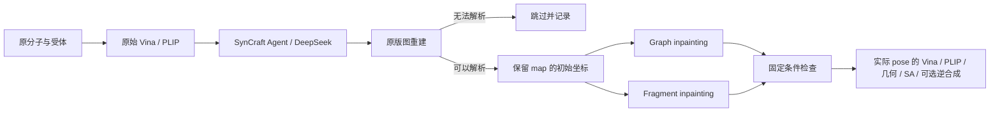

# 原生 FLOWR 适配边界

控制层 `design_runner.py` 复用 SynCraft 检索、原始提示/解析和图重建；`inpainting_runner.py` 把实际重建的图交给独立适配器，并在 FLOWR 之后评价。此前不含历史信息的 `foundation_run` 保留为对照。轨迹信息由已有增强接口额外注入，不替代 SynCraft 底座。

`inpainting_contracts.py` 定义输入、掩码、样本和运行结果的版本契约；`inpainting.py` 实现规划和子进程调用；`workers/flowr_inpainting.py` 在 FLOWR 的解释器中运行原生 `generate_from_pdb.py`。worker 只核对预处理的原子顺序和实际 keep-mask，不替代上游模型或修改第三方代码。三个 Git 子模块均固定 revision，FLOWR 无输出文件随仓库发布。

原子 map 与 RDKit 索引、FLOWR 输入 slot、输出 slot 明确区分。片段模式会把固定原子重排至输出前部；可生成区域的原子不得继承旧 map 身份，新原子分配独立命名空间。Graph 模式保留整个编辑图。两种模式均启用原生最终 inpaint；之后检查实际输出，不使用后处理伪造保留结果。

SynCraft `src/extract_interaction.py::format_interactions_for_llm` 允许为合成修复替换方向性互作原子，要求预期恢复互作几何；疏水等为软偏好。故默认 `interaction_policy=syncraft_compatible`，在 LLM 编辑完成后固定仍存活的互作原子和实际编辑区域。原互作删除/改变只记录，不触发默认硬拒绝。`strict` 是显式可选研究设置，不是默认值。片段采样期间的固定条件仍需保持。

`pose_initialization.py` 只负责初始条件：复制存活原子坐标，必要时为新增原子生成受约束初始坐标，并保存来源哈希。此步骤和 FLOWR 采样、最终合理性检查分别记录。生成后 `SynCraftGeometry.evaluate_pose` 直接处理 SDF；默认 score-only 不重嵌入或松弛重原子。其 protocol ID 包含 pose 哈希和评价模式，避免与普通 redocking 混用。MMFF 测量在副本上进行，原始坐标保持。

单个工程例子只验证接口可运行。正式实验需要等预算无 inpainting 对照、固定掩码策略、多个采样种子，以及把结构有效率、可接受保留率、Vina/互作、SA 和固定库存路线结果分别报告。未配置库存时不能宣称完成逆合成验证。
