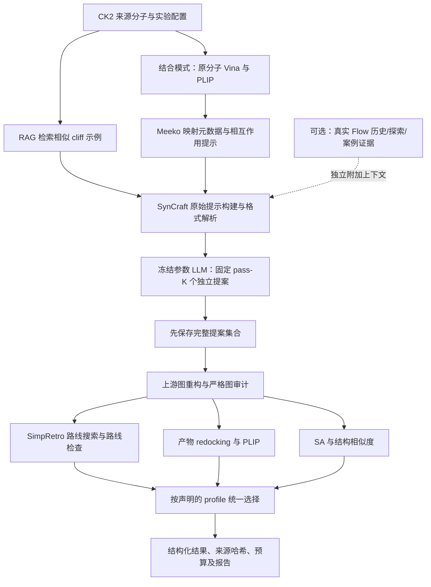

# SynCraft 完整运行底座与可选生成信息增强

2026-10-18 更新：独立严格编辑器已移除，所有运行入口统一采用 `SynCraftEditor` 和原版执行语义；编辑范围只用于提示。裁片不再被二次否决，原始返回值与失败阶段单独保存。当前接口和复测见 [NATIVE_SYNCRAFT_VALIDATION.md](NATIVE_SYNCRAFT_VALIDATION.md)。以下 2026-10-16/17 的严格审计说明及结果属于历史协议。

2026-10-19 更新：新增可独立克隆的三个官方子模块、独立 DeepSeek API、设计后延迟评价和两种原生 FLOWR inpainting，详见 [FLOWR_INPAINTING.md](FLOWR_INPAINTING.md)；当前服务器环境与完整模板验收见 [REMOTE_ENVIRONMENT_20261019.md](REMOTE_ENVIRONMENT_20261019.md)。

2026-10-17 更新：已补齐完整发布语料、官方 eMolecules 库存、全模板的内存适配与双模式合并；真实 CK2 示例和非零路线检查的当时记录见 [OFFICIAL_EXAMPLE_VALIDATION.md](OFFICIAL_EXAMPLE_VALIDATION.md)。下文保留 2026-10-16 的实现和验证历史，其“尚未跑通”状态不替代新记录。

更新：2026-10-16。适用范围：CK2 小分子候选的计算方法评估。本文是当前底座的实现与运行说明；2026-10-15 的 `agenticgen.run.v1` 属于保留的旧版局部编辑工程基线。

AgenticGen 现在以 SynCraft 的完整运行机制组织组件：参考语料、相似案例检索、原始提示构建、可替换 LLM、pass-K 编辑生成、图执行与检查、逆合成评价、docking/PLIP 约束和候选选择。Flow-matching 历史由独立的 `EvidenceInjector` 提供，默认关闭。所有结果都属于计算预测。

## 1. 底座的数据流



pass-K 中的所有提案在评价产物之前生成，候选 SA/路线/docking 不反馈给同轮后续提案。它们是独立提案，不是多轮学习。跨轮反馈和经验累计属于计划中的 L3。

## 2. 已接入的模块与上游来源

SynCraft-Core 固定 commit：`557703e110b26a354afed2955ded5217837f6692`。SimpRetro 固定 commit：`5abbdd12d23bec3b0c524a3f5e59d160beac00f3`。

| 机制 | AgenticGen 模块 | 实际复用与行为 |
| --- | --- | --- |
| Cliff 案例语料 | `adapters/syncraft.py` | 加载上游 `assets/reasoning.json`，排除当前输入完全相同的源图 |
| 示例检索 | 同上 | 调用上游 `get_similar_examples`，Morgan 半径 2/2048 位，默认 5 例 |
| 原始提示与解析 | `native.py` | 分别读取 standard / interaction-aware 的 `create_system_prompt`、`create_user_prompt`，调用原解析器 |
| LLM 传输 | `native.py` | 默认 EvoMolSteer 的 `deepseek-flash`；可换 LiteLLM 原生文本传输；replay 必须显式选择 |
| pass-K | `base_runner.py` | 默认 5 个提案；失败记入固定预算，不化学重采样 |
| 图执行 | `editing.py` | 真实调用 `reconstruct_from_sequence`，独立参考图用于审计；不替代上游失败产物 |
| 逆合成 | `adapters/retro.py` | 固定库存、模板、单核预算、内部 seed=0，支持外部 Python 和 Docker |
| 路线导出检查 | `workers/retro_route.py` | 只读取本任务搜索新生成的图；核对目标、库存叶节点、图结构与模板回放 |
| 原分子 docking/PLIP | `adapters/geometry.py`、`workers/syncraft_geometry.py` | 隔离执行上游 ligand preparation/Vina；复用上游相互作用提示格式 |
| 原子对齐 | `workers/plip_alignment.py` | 使用 Meeko `SMILES IDX` 元数据，将 Vina/PLIP 的原子序号绑定到源图 atom map |
| redocking 与接触保留 | geometry worker、`selection.py` | 原/新图分别建模，保持 atom map 身份，报告接触类型/残基/原子集合的保留率 |
| 候选选优 | `selection.py` | 提供论文路线策略、发布 skill 策略和仅推理诊断策略 |
| 参考库再构建 | `corpus.py` | 从用户提供的 source/target/解释/证据对，调用上游 IterativeMCSExtractor 并核验重构目标 |
| 可选生成证据 | `enhancements.py` | 按 case ID、源图哈希、证据类型与长度预算检查，之后附加到同一底座提示中 |
| 运行与报告 | `base_factory.py`、`base_reporting.py`、CLI | 组件注入、协议/源码哈希、缓存命中、用量、结果重汇总 |
| Python / Agent Skill 入口 | `api.py`、`skills/syncraft-foundation/SKILL.md` | 可配置的 `optimize(config, output)` 和项目内 skill 使用说明 |

本项目没有检索额外生物风险知识库。结合模式示例只指向由宿主提供的 CK2 受体与盒子配置，不自动下载受体。

## 3. 三种显式选择协议

| 配置策略 | 合格条件 | 选择规则 | 可支持的结论 |
| --- | --- | --- | --- |
| `paper_route_similarity` | 图有效、相似度严格高于阈值、SimpRetro 报告找到路线；可要求额外路线检查通过 | 合格候选中相似度最高，平分取较早提案 | 当前协议下是否找到保留结构的可达候选 |
| `skill_sa_binding` | 图有效、相似度>0.2、原/新 docking 成功、Vina 恶化≤1 kcal/mol、SA 可用 | SA 最低，平分取相似度较高者 | 发布 skill 所采用的受结合分数约束的 SA 选优 |
| `proposal_only` | 执行并记录提案和图检查 | 不产生“优化胜出分子” | 接口与提案生成的工程诊断 |

论文策略默认使用 ECFP4/4096 位作为选择相似度，检索仍使用 2048 位；skill 示例选择相似度用 2048 位。配置中分别记录，不能把图编辑器内部相似度和最终选择相似度混用。

`route_found` 表示搜索报告；`route_verified` 仅表示图/库存/模板回放检查通过，不包括实验条件、产率或真实实验成功。`no_route_within_budget`、输入错误和基础设施错误分别保存。原分子已经找到路线时，产物可以被选择，但不会计为“路线救回”；`route_rescue` 的分母只包含原分子在同协议下未找到路线的案例。

源和产物的路线搜索按 canonical graph 缓存；结合评价还要求 mapped graph 一致，因此新增原子（ID≥500）不会与其他分子的原子混同。缓存范围仅为同一运行、同一评价器协议。物理调用数与逻辑提案数分开记录。

## 4. 对上游的审计修正与运行配置差异

底座复用真实上游函数，同时保留以下明确的包装差异：

- 图审计拒绝隐式片段删除、未声明的手性/同位素丢失、价态错误和违反保护范围的修改。不会因为上游返回了 SMILES 就判为通过。
- 新底座默认容量上限为 256 个操作、增加/删除各 128 个原子；最终相似度由选择协议决定。旧版“6 操作/2 原子”仅用于保留的局部编辑配置。
- 结合 worker 固定 embedding/Vina seed；使用显式 Meeko 映射元数据。PLIP 复合物采用独立配体链及无冲突原子序号；PLIP 修复 PDB 后再通过原子名、元素和保持不变的坐标核对重编号，解析时要求配体原子完整映射。
- 不使用上游 ligand preparation 中丢弃手性后的结果；若元数据身份发生变化则失败。PLIP 结果仍是计算接触预测。
- 原生 `[REASONING]/[EDITS]` 格式保留；宿主要求简洁化学解释和不确定性，不要求私有思维轨迹。解释不作为合成因果真值。
- 默认 EvoMolSteer 传输为 `deepseek-flash`、temperature=0、thinking disabled，通过 JSON envelope 携带原始 SynCraft 文本。LiteLLM 可配置其他已授权模型和参数。
- skill 模式的 SA 不可用时，当前实现明确排除该候选；不自动切换成只按结合分数排名。

因此，这是一套有明确审计修正的 SynCraft 运行底座。模型、温度、依赖版本、图审计和外部库存均写入配置/manifest，不能自动将其数值结果称为论文完全同设置复现。

## 5. CK2 示例与命令

在 AgenticGen 根目录使用已安装的 `.venv`：

```powershell
# 无 API，真实调用上游提示、检索、解析和图执行
.venv/Scripts/python.exe -m agenticgen run --config examples/syncraft_foundation/standard.engineering.json --output outputs/foundation_replay

# CK2 一个已冻结候选，真实生成 5 个提案；只诊断提案，不声称完成路线优化
.venv/Scripts/python.exe -m agenticgen run --config examples/syncraft_foundation/standard.inference.json --output outputs/foundation_live

# 完整标准路线策略：要求真实逆合成环境与固定原料库
.venv/Scripts/python.exe -m agenticgen preflight --config examples/syncraft_foundation/standard.paper.json
.venv/Scripts/python.exe -m agenticgen run --config examples/syncraft_foundation/standard.paper.json --output outputs/ck2_paper_profile

# 从本地 CK2 对齐蛋白/参考配体准备受体和盒子；不下载结构
.venv/Scripts/python.exe -m agenticgen prepare-ck2-receptor --protein ../../EvoMolSteer/data/reference_terminal/original/inputs/3PE1_protein_aligned.pdb --reference-ligand ../../EvoMolSteer/data/reference_terminal/original/inputs/3PE1_ligand_aligned.sdf --output outputs/ck2_receptor_prepared

# 完整结合模式：示例已指向上述本地准备结果；其他主机可以修改对应配置路径
.venv/Scripts/python.exe -m agenticgen run --config examples/syncraft_foundation/interaction.live.json --output outputs/ck2_interaction

# 只从已有结果重建汇总，无 API、搜索或 docking
.venv/Scripts/python.exe -m agenticgen summarize --run outputs/syncraft_foundation_ck2_live_20261016
```

需在进程环境设置 `DEEPSEEK_API_KEY`；可使用已有示例启动脚本读取 Windows 用户级凭据。所有路径相对于配置文件，输出目录必须尚不存在。

Docker 环境构建：

```powershell
docker build -t agenticgen-syncraft-worker:20261015 environments/syncraft-worker
docker build -t agenticgen-simpretro-worker:20261016 environments/simpretro-worker
```

运行时以实际镜像 ID 固定协议，worker 默认禁用容器网络；Dockerfile/conda 环境是部署配方，实际就绪情况以预检、运行记录及下节验证为准。SimpRetro 的 `ASScore` 还会从当前目录读取 `emolecules.txt`，适配器将它绑定到配置指定的同一库存，避免搜索叶节点与内部评分使用不同原料库。目录名称不会把该库存改成 eMolecules；库存来源必须另外登记。

## 6. Flow-matching 信息如何成为额外增强

`standard.history.json` 从 `standard.paper.json` 使用相同底座配置，只开启 `enhancements`，从 `${FLOW_HISTORY_PACKETS}` 读取已冻结证据。数据契约见 `schemas/enhancement-packet.schema.json`；每条包含 `case_id`、`source_graph_sha256`、`kind`、真实测量摘要 `text` 和 `evidence_ids`。

基线关闭时不打开任何 packet 文件。开启时，全部源案例都必须有匹配图哈希的证据；不同种类（历史/探索/记忆）需要显式许可；超出固定输入预算直接失败。当前实现负责可控注入，不会编造轨迹，也没有自动从文字推导化学因果机制。FLOWR 状态提取、原生 steer 采集和 inpainting 仍通过项目计划中的生成器端口扩展。

正式比较 T 与 T+H 时，仅改变 evidence 开关/文件；固定模型、参考库、pass-K、编辑空间、路线/结合评价及选择协议。原有 source affinity-head 值不复制给产物；需要独立评价新图的结合和几何性质。

## 7. 本次验证与实际运行边界

已执行的验证：

- 46 项自动化测试通过，0 skipped，Ruff 检查通过。覆盖原始提示/解析、pass-K 冻结、严格图执行、MCS 参考库重构、路线与 skill 选优、缓存、证据开关/图绑定、PLIP 配体身份/重编号与 atom map 对齐，以及参考配体定义盒子。
- 在现有 docking Docker 环境中，对 CK2 源分子的 25 个重原子执行了真实 RDKit/Meeko 元数据往返校验，通过；该检查没有执行 docking。
- 真实 `deepseek-flash`：CK2 `single_b004_final_027`，5 个提案、5 次 HTTP 请求，均解析成功；3 个编辑接受、2 个拒绝。3 个接受提案归并为同一个独立产物，SA 从 2.86612664 降至 2.75500413，Δ=0.11112252。没有将重复提案计成 3 个独立分子。
- 本次 API 用量：输入 16,205 / 输出 1,410 token。保存于 `outputs/syncraft_foundation_ck2_live_20261016/`，原始调用与决策保留。
- 本地 CK2 受体准备通过：2765 个蛋白 ATOM；使用 3PE1 对齐参考配体定义盒子，保存输入/输出哈希和实际镜像 ID，未搜索其他靶点或外部知识库。
- 结合模式的独立工程联调使用人工固定的 5 个相同去甲基提案，实际执行原分子和产物两次 Vina/PLIP。Vina 为 −11.805 → −11.561 kcal/mol，SA 为 2.8661 → 2.7269；依照发布 skill 的规则选出产物。原分子 10 项接触中精确保留 6 项；其中两项氢键变为一项，不能宣称完整保留结合模式。该运行是 replay，不是 LLM 性能实验，保存于 `outputs/syncraft_ck2_binding_checked/`。
- SimpRetro Docker 已构建；使用 1 个模板、3 个库存分子和库存内 CCO 的零步工程案例，搜索、序列化、解析、目标/库存检查通过。此例不涉及非零反应步骤，也不能证明 CK2 可合成。全量 51,720 模板启动检查返回 137；Docker 可用内存约 8.33 GB，尚未确认退出原因，需在合适运行资源上重新核验。记录位于 `outputs/syncraft_foundation_retro_engineering/`。

真实 API 运行使用 `proposal_only`，`selected_case_count=0`、`full_method_runtime_evaluated=false`；单独的结合模式 replay 联调使用真实 docking/PLIP。没有执行 CK2 的完整逆合成或历史对照；源分子的原始高预测亲和力不能继承给产物。

完整数值实验还需要固定的 Enamine（或明确另立协议的其他）原料库，以及通过全模板检查的 SimpRetro 运行资源。CK2 受体和盒子已在本机准备并联调；跨主机需重新核验输入。缺失依赖会直接报告，不退化到其他选择策略或模式。

早期结合工程联调 `outputs/syncraft_ck2_binding_validation/` 因未处理 PLIP PDB 重编号导致接触映射错误，已用 `audit_correction.json` 标记为 invalidated；不使用该轮接触或保留率。当前 `binding_checked` 运行完成了修正后的完整映射和 N/O/S 氢键原子、环上 π 接触审计。
