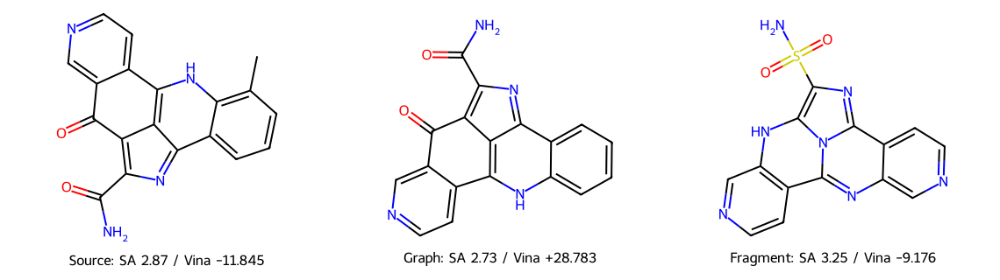

# 2026-10-19 真实运行的小型结果包

来自 CK2 TOP1 的两次真实 DeepSeek 请求；一条不可解析并跳过，一条去甲基设计进入两种原生 FLOWR inpainting。两个生成结构均完成 Vina/PLIP、几何及完整库存逆合成评价。

实际三维位姿保存在 `source.sdf`、`graph_0000.sdf`、`fragment_0000.sdf`；二维重绘不能反映三维应力。Graph 几何严重异常，Fragment 虽找到经模板/库存验证的路线，结合分数及应力也未达可接受改进。

`summary.json` 保留原生设计、数值、API 收据摘要及评价协议；`*.preservation.json` 是固定区检查，`*.runtime.json` 是原生模型执行收据，`fragment_0000.route.json` 是计算路线验证。`files.sha256.json` 绑定数据文件字节。原始完整日志和大文件没有随该包上传。

完整解释见[远端验收报告](../../../docs/REMOTE_EXAMPLE_VALIDATION_20261019.md)。此包用于工程复核，不是方法效果基准。
